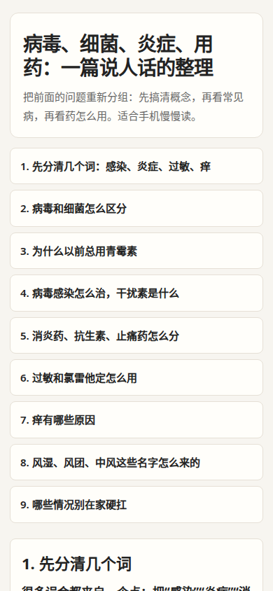
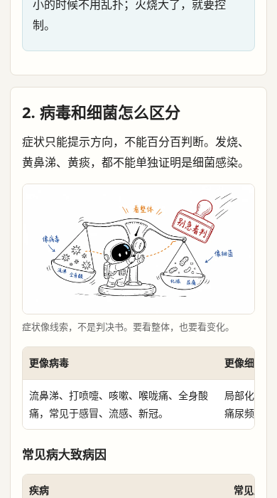

<p align="right"><a href="README.md">中文</a></p>

<p align="center">
  
</p>

<p align="center">
  <a href="https://health-book.xiaosang.cc/">▶ Read Online</a>
  ·
  <a href="https://github.com/holynova/health-book">GitHub Repository</a>
</p>

A plain-language health guide in Chinese: untangles commonly confused ideas — infection vs inflammation, antibiotics vs anti-inflammatories — and clears up everyday medication myths. Nine short chapters, example-first, written for phone reading, each with a hand-drawn illustration starring Xiao Hei, a cute astronaut.

## Screenshots

<p align="center">
  
  
</p>

## 9 Chapters

| Ch. | Title | What it covers |
|----|------|--------|
| 1 | 先分清几个词 (First, Get the Words Straight) | Infection, inflammation, allergy, itch — align the terms first |
| 2 | 病毒和细菌怎么区分 (Telling Viruses and Bacteria Apart) | Symptoms are only clues, never 100% certain; a table of common causes |
| 3 | 为什么以前总用青霉素 (Why Penicillin Was Used So Often) | The history of antibiotics and how overuse began |
| 4 | 病毒感染怎么治 (Treating Viral Infections) | What interferon is, and how viral infections are treated |
| 5 | 消炎药、抗生素、止痛药怎么分 (Anti-inflammatories, Antibiotics, Painkillers) | What each type treats — don't mix them up |
| 6 | 过敏和氯雷他定怎么用 (Allergies and Loratadine) | Allergy triage and how to use anti-allergy medication |
| 7 | 痒有哪些原因 (What Causes Itching) | Itching has more than one cause |
| 8 | 风湿、风团、中风这些名字怎么来的 (Where Disease Names Come From) | The word origins behind rheumatism, hives, and stroke |
| 9 | 哪些情况别在家硬扛 (When Not to Tough It Out at Home) | Signs it's time to see a doctor — don't wait |

> Disclaimer: this guide is general health education, not medical diagnosis. If you feel unwell, see a doctor promptly.

## Illustrations

The 9 illustrations were AI-assisted, drawn in the Xiao Hei (cute astronaut) IP with a pure-white hand-drawn style, one per chapter, in PNG + WebP (the `<picture>` element prefers WebP), under `assets/medicine-basics-illustrations/`.

## Run Locally

A single static file — double-click `index.html` to open it, or serve it statically:

```bash
python3 -m http.server 8000
# Open http://localhost:8000
```

## Tech

- Pure static HTML5 / CSS3, a single `index.html` with inline styles — no framework, no build step.
- Mobile-first: short paragraphs, card table of contents, anchor navigation; centered adaptively on desktop.
- Illustrations in PNG + WebP, loaded on demand via `<picture>`.

```
index.html                              The whole site: 9 chapters + inline styles
assets/medicine-basics-illustrations/   9 illustrations (PNG + WebP)
```
