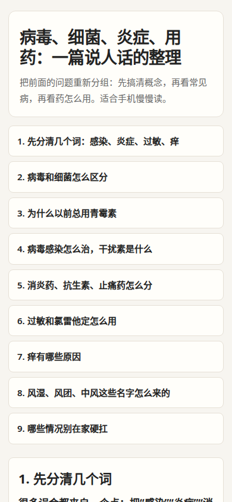
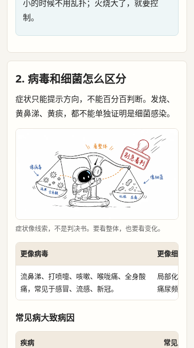

<p align="right"><a href="README.en.md">English</a></p>

<p align="center">
  
</p>

<p align="center">
  <a href="https://health-book.xiaosang.cc/">▶ 在线阅读</a>
  ·
  <a href="https://github.com/holynova/health-book">GitHub 仓库</a>
</p>

一篇说人话的医学科普：帮大众分清感染、炎症、抗生素、抗炎药这些容易混的概念，理清常见病因与用药误区。9 个章节，短段落、举例子，手机上慢慢读正好；每章配一张可爱宇航员（小黑）手绘插画，晦涩概念画出来就好懂了。

## 截图

<p align="center">
  
  
</p>

## 9 个章节

| 章 | 标题 | 讲什么 |
|----|------|--------|
| 1 | 先分清几个词 | 感染、炎症、过敏、痒，先把词对齐 |
| 2 | 病毒和细菌怎么区分 | 症状只是线索，不能百分百判断；常见病大致病因表 |
| 3 | 为什么以前总用青霉素 | 抗生素的历史与滥用背景 |
| 4 | 病毒感染怎么治 | 干扰素是什么，病毒感染的治疗思路 |
| 5 | 消炎药、抗生素、止痛药怎么分 | 三类药各治什么，别混着吃 |
| 6 | 过敏和氯雷他定怎么用 | 过敏分流与抗过敏药用法 |
| 7 | 痒有哪些原因 | 痒不只是一种原因 |
| 8 | 风湿、风团、中风这些名字怎么来的 | 病名背后的词源故事 |
| 9 | 哪些情况别在家硬扛 | 该去医院的信号，别拖 |

> 免责声明：本页为大众健康科普，不是医疗诊断；身体不适请及时就医。

## 插画

9 张配图由 AI 辅助生成，采用可爱宇航员（小黑）IP 与纯白手绘风格，每章一张，PNG + WebP 双格式（`<picture>` 优先 WebP），在 `assets/medicine-basics-illustrations/`。

## 本地运行

纯静态单文件，双击 `index.html` 即可打开；或起静态服务器：

```bash
python3 -m http.server 8000
# 打开 http://localhost:8000
```

## 技术

- 纯静态 HTML5 / CSS3，单文件 `index.html`（样式内联），零框架、零构建。
- 移动优先：短段落、卡片目录、锚点跳转，桌面端自适应居中。
- 插画 PNG + WebP 双格式，`<picture>` 按需加载。

```
index.html                              全站：9 章内容 + 内联样式
assets/medicine-basics-illustrations/   9 张插画（PNG + WebP）
```
